# Práctica Claude Code 101

Registro de la práctica con un proyecto pequeño (script en Python que lee facturas en CSV y genera un resumen) para probar todas las funciones de Claude Code.

## Plan de práctica

| Paso | Actividad | Función que se prueba | Estado |
|---|---|---|---|
| 1 | Crear la carpeta, ejecutar `claude` y pedir el script en **Modo Plan** | Modos de permisos y Modo Plan | ✅ |
| 2 | Aprobar el plan y dejar que escriba código y pruebas | Explorar → Planificar → Codificar | ✅ |
| 3 | Revisar cambios con `/diff` y pedir `/code-review` | Revisión de código | ✅ |
| 4 | Ejecutar `/init` para crear el `CLAUDE.md` | Memoria persistente | ✅ |
| 5 | Crear un subagente con `/agents` que valide los datos | Subagentes | ☐ |
| 6 | Crear una skill con el formato de commits | Skills | ☐ |
| 7 | Agregar un servidor MCP y revisar `/context` | MCP y costo de contexto | ☐ |
| 8 | Configurar un hook que bloquee la edición de `facturas_originales/` | Hooks (código de salida 2) | ☐ |
| 9 | Usar `/compact` y `/clear` entre tareas | Gestión del contexto | ☐ |

---

## Bitácora

<!-- Aquí se irá agregando la información de cada sesión de práctica. -->

### Sesión 1 — 2026-10-11 · Paso 1: Modo Plan

**Proyecto real de la práctica:** *Prototipo móvil de dosificación veterinaria* (HTML, CSS y JavaScript) que calcula la dosis de medicamento para animales según su peso. Reemplaza la idea inicial del script de facturas en CSV.

**Entorno:** Claude Code en la terminal de VS Code.

**Qué hice:**
- Activé el **Modo Plan** con `Shift + Tab`. En la parte inferior aparece `plan mode on (shift+tab to cycle)`.

**Qué observé:**
- `Shift + Tab` recorre los modos en ciclo; el modo activo se muestra debajo del campo de texto.
- La barra inferior también muestra `← for agents` (acceso a los agentes).
- En Modo Plan, Claude no escribió código: primero pidió información para planificar.
  - Pidió que las **historias de usuario** incluyan **criterios de aceptación**.
  - Preguntó qué **especies** cubre la app, qué **unidades** usa (kg o lb, mg/kg, mL) y si las dosis vienen de una **lista fija de medicamentos** o las ingresa el usuario.
- Claude Code muestra un **recap** (resumen) del estado de la sesión al terminar; se puede desactivar en `/config`.

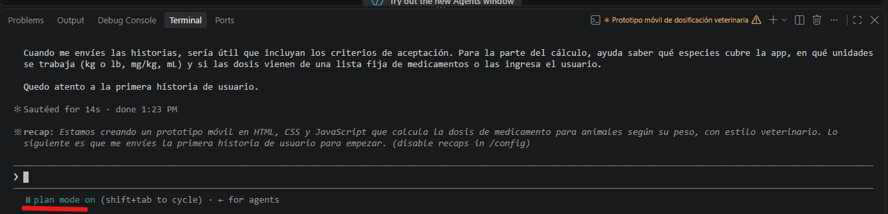

**Modo de aceptación automática:**
- Al presionar `Shift + Tab` de nuevo, el modo cambió a `accept edits on` (ícono `⏵⏵`).
- En este modo Claude **edita archivos sin pedir permiso**, pero **aún pide aprobación para ejecutar comandos**.
- Ciclo observado: Plan Mode → accept edits → … (se repite con `Shift + Tab`).

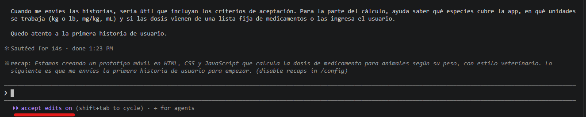

**Primera solicitud (HU-01: Categorías de medicamento)** — enviada en **Modo Plan**:
- Crear, editar y eliminar categorías de medicamento (ej.: antibióticos, desparasitarios).
- Cada categoría tiene un **código numérico** que la identifica.
- **No permitir categorías duplicadas.**
- **No permitir borrar** una categoría que tenga datos asociados.
- Mostrar una **tabla tipo Excel** (máximo 3 registros) con botones de editar y borrar, y un botón para crear una nueva categoría.
- Se le pidió a Claude que **expresara sus dudas antes de codificar**.

**Qué observé:**
- Ruta del proyecto: `D:\AppMedicamento`.
- Antes de responder, Claude ejecutó `ls -la /d/AppMedicamento` para revisar la carpeta: es la fase **Explorar**, con un comando de solo lectura permitido en Modo Plan.
- La barra inferior muestra `esc to interrupt`: se puede detener a Claude mientras trabaja.

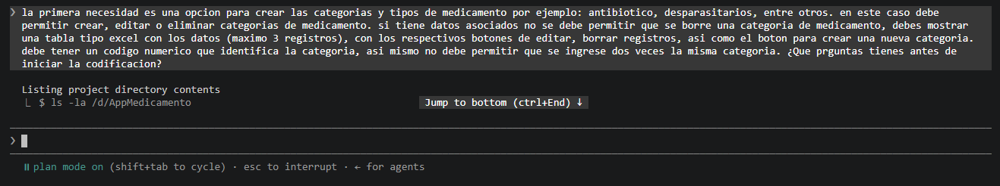

**Preguntas de Claude (formulario interactivo):**
- Claude guarda el plan en un archivo: `C:\Users\Arnulfo\.claude\plans\la-primera-necesidad-es-groovy-stream.md`.
- Las preguntas aparecen como **pestañas** que se recorren en orden: `3 registros` → `Código` → `Campos` → `Datos` → `Submit`. Las respondidas se marcan con ☒.
- Cada pregunta trae opciones, una marcada como **(Recomendado)**, más "Type something" (respuesta libre) y "Chat about this" (conversarlo).
- Navegación: `Enter` selecciona, `Tab`/flechas navegan, `Esc` cancela.

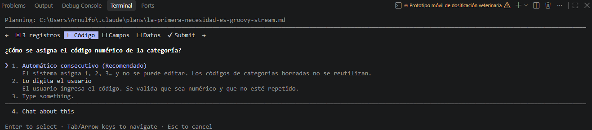

| # | Pregunta de Claude | Respuesta |
|---|---|---|
| 1 | ¿Qué significa "máximo 3 registros" en la tabla? | **Paginación de 3** (Recomendado) |
| 2 | ¿Cómo se asigna el código numérico de la categoría? | **Automático consecutivo** (Recomendado): 1, 2, 3…, no editable, no reutiliza códigos borrados |
| 3 | ¿Qué campos tiene una categoría, y "categorías y tipos" son lo mismo? | *Respuesta libre:* en realidad se llama **clasificación**: antibióticos, analgésicos, anestésicos, antifúngicos, fármacos endocrinos, vacunas |
| 4 | ¿Dónde se guardan los datos? Aún no existen medicamentos, ¿cómo se prueba la regla de "no borrar si tiene datos asociados"? | **localStorage + ejemplos** (Recomendado) |

- Antes de enviar, Claude muestra una pantalla **"Review your answers"** para revisar todo y luego **Submit answers** o **Cancel**.
- Se enviaron las respuestas.

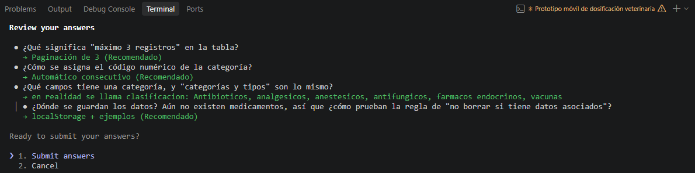

**Aprobación del plan y codificación:**
- Claude entregó el plan y se **aprobó**. Empezó a escribir código de inmediato.
- Al aprobar, el modo pasó a **`auto mode on`** (modo automático): Claude trabaja sin pedir permiso mientras una verificación de seguridad revisa cada acción en segundo plano.
- La sesión tomó un nombre propio: **`gestion-clasificaciones-medicamento`** (visible en la pestaña de la terminal y en la línea del prompt).
- Primer archivo creado con la herramienta **`Write`**: `img\empty.svg` (22 líneas), una ilustración SVG de un perro para el **estado vacío** de la tabla. Claude muestra el contenido escrito línea por línea.

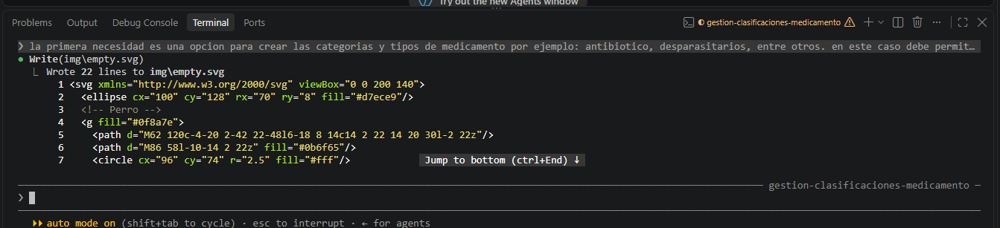

**Resultado de la codificación (HU-01 terminada):**
- La app se llama **VetDosis** ("Cálculo de medicamentos por peso"), con diseño móvil.
- Claude dejó la página abierta en Chrome en `http://localhost:5500/index.html`, con un **servidor local** corriendo (la barra muestra `1 shell`: un proceso en segundo plano). También se puede abrir `index.html` con doble clic.
- **Tabla tipo Excel:** columnas Código, Nombre y Acciones (editar ✏️ / borrar 🗑️). Muestra **3 registros por página** con botones Anterior/Siguiente ("Página 1 de 2").
- Botón **"+ Nueva clasificación"**.
- Datos de ejemplo: 1 Antibióticos, 2 Analgésicos, 3 Anestésicos…
- Barra inferior con pestañas **Clasificaciones**, **Medicamentos** y **Calcular** (las dos últimas aún no solicitadas; revisar si son solo marcadores).

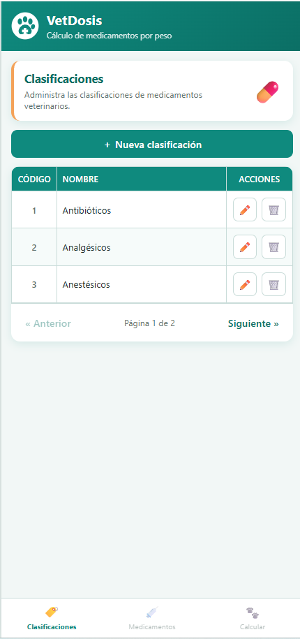

### Paso 3: Revisión de código

- Se escribió `/code-review` en el prompt. Al teclear `/`, Claude Code muestra un **autocompletado** de comandos y skills, por ejemplo `/code-review` y `/marketing:brand-review` (skill de un plugin).
- El autocompletado menciona **3 `/ultrareview` gratis**: una revisión más profunda del diff, un PR o una rama.
- El indicador `[In index.html]` muestra que el archivo abierto en VS Code se incluye como contexto.

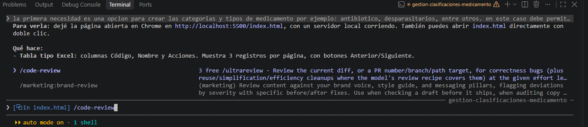

**Hallazgos de `/code-review`:**
- La revisión tomó unos **26 segundos** ("Baked for 26s") y el servidor local siguió activo ("1 shell still running").
- Claude reportó **10 puntos**. Algunos visibles en la captura:
  - Elementos del menú inferior que se pueden activar con el teclado (accesibilidad).
  - **7.** El encabezado fijo de la tabla no tiene efecto: con 3 filas la tabla nunca se desplaza. Propone quitarlo.
  - **8. Limpieza:** lógica de espacios repetida en dos funciones, y la lista se lee del almacenamiento en cada clic sobre la tabla.
- Recomendación de Claude: corregir los 10 puntos, porque son cambios pequeños y conviene resolverlos **antes del módulo de Medicamentos**, que dependerá de estos códigos.
- `/code-review` **solo reporta, no edita**: Claude preguntó "¿Los aplico?" y espera aprobación.

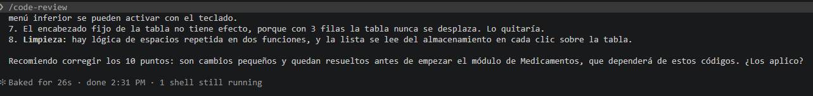

**Decisión:** se aceptaron las mejoras para que Claude haga los ajustes en el código.

**Pendiente:** verificar los ajustes del code-review con `/diff` y probar la app de nuevo.

### Paso 4: CLAUDE.md con `/init`

- Se ejecutó `/init` para que Claude genere el archivo `CLAUDE.md` del proyecto.
- Mientras trabaja, muestra el estado **"Churning…"** y un **tip**: `CLAUDE_CODE_USE_POWERSHELL_TOOL=1` activa la herramienta de PowerShell (vista previa), útil en Windows.
- Barra inferior: `auto mode on · 1 shell · esc to interrupt · ← for agents · ↓ to manage`. La opción **`↓ to manage`** permite gestionar el proceso en segundo plano (el servidor local).
- Nota: se recomienda empezar sin `CLAUDE.md` y crearlo cuando ya se sabe qué corregirle a Claude. Aquí ya hubo una HU completa y un code-review, así que es buen momento.

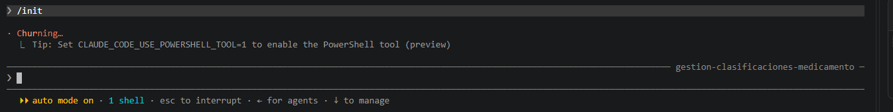

**Resultado de `/init`:**
- Se creó `CLAUDE.md` en la **raíz del proyecto** (3,4 KB).
- Estructura del proyecto en ese momento: `css/styles.css`, `img/` (`empty.svg`, `logo.svg`), `js/` (`clasificaciones.js`, `storage.js`), `docs/` (esta bitácora), `CLAUDE.md` e `index.html`.

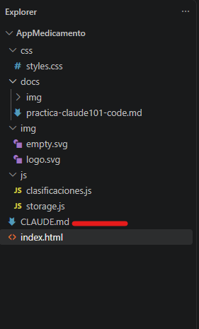

**Qué contiene el `CLAUDE.md`** (Claude lo escribió en inglés):

| Sección | Contenido |
|---|---|
| **Project** | VetDosis: prototipo móvil en HTML, CSS y JavaScript puro, sin frameworks ni build ni pruebas automáticas. Se construye por historias de usuario (HU-xx). Textos y código en español. |
| **Running** | Abrir `index.html` o usar `python -m http.server 5500`. Claude in Chrome no abre `file://`, por eso usa el servidor local. Se verifica probando los botones en tamaño de teléfono. Cómo reiniciar los datos borrando las llaves `vet_*` de `localStorage`. |
| **Architecture** | `index.html` de una sola página con dos modales y un toast. `storage.js` es el único que toca `localStorage` (llaves `vet_clasificaciones`, `vet_medicamentos` de ejemplo y `vet_seq_clasificacion`). Las pestañas Medicamentos y Calcular son marcadores deshabilitados. |
| **Domain rules (HU-01)** | 3 filas por página. Nombres duplicados se rechazan tras normalizar (espacios, mayúsculas y tildes). No se borra una clasificación con medicamentos asociados. |
| **Conventions** | Diseño móvil (`max-width: 480px`), colores en variables CSS, imágenes SVG locales sin CDN, nunca `alert`/`confirm`/`prompt`. |

**Qué observé:**
- Recoge las **decisiones del Modo Plan** (código consecutivo que no se reutiliza, `localStorage` con datos de ejemplo) y aclara que los medicamentos de ejemplo se deben reemplazar al construir ese módulo.
- Resolvió la duda de las pestañas: **Medicamentos y Calcular son marcadores** para historias futuras.
- **Detectó la carpeta `docs/`** y agregó una regla: es la bitácora de aprendizaje, no documentación de la app, y solo se edita si se pide.
- Está en inglés aunque el proyecto es en español; se puede pedir que lo traduzca.
- Se abrió en VS Code con **Markdown Preview** (`Ctrl + Shift + V`) para leerlo con formato.

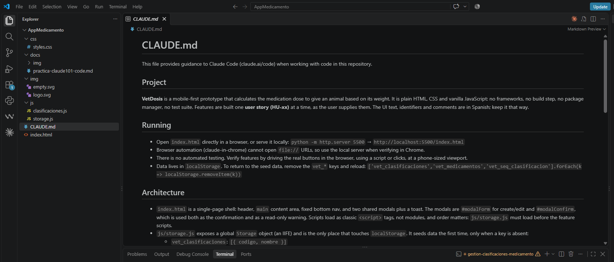

> **Lección aprendida — `/diff` necesita git:** `/diff` compara el código actual contra el último commit. La carpeta `D:\AppMedicamento` **no era un repositorio git** (sin carpeta `.git`), así que `/diff` no tenía con qué comparar. Solución: pedirle a Claude *"inicializa git y haz un primer commit con el estado actual"* y usar `/diff` desde la siguiente HU.
>
> Momento de uso en el flujo: Claude termina la tarea → **`/diff`** (revisión propia) → `/code-review` (segunda opinión) → commit.

**Pendiente:** inicializar git con un primer commit y continuar con el Paso 5 (subagentes).
